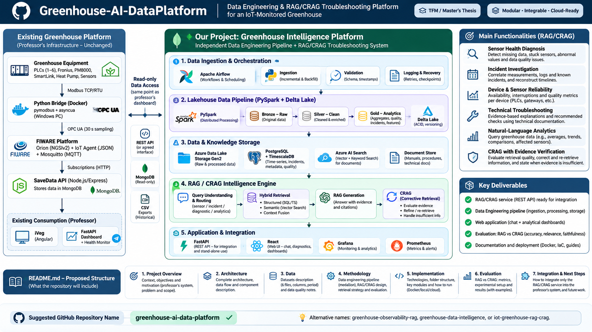
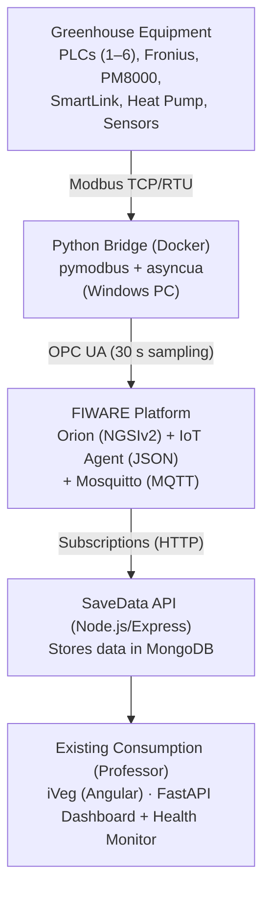
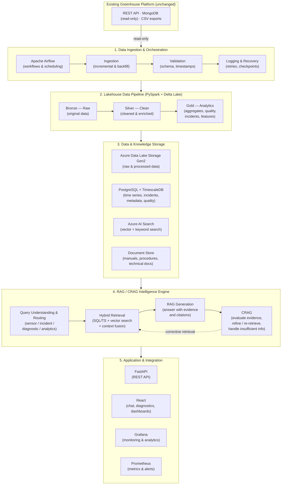
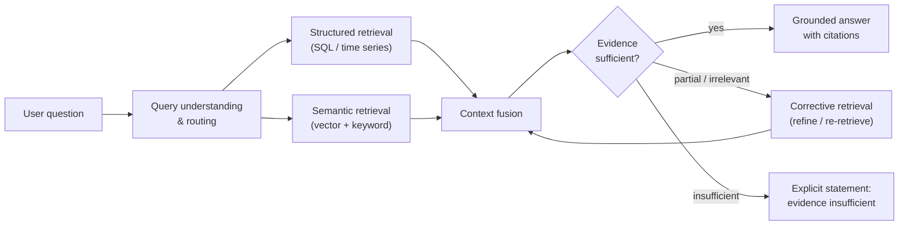
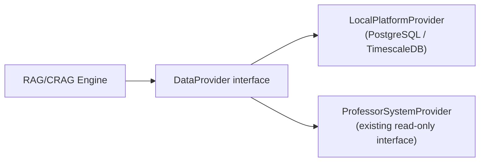

# Greenhouse Intelligence Platform
### An Independent Data Engineering and Hybrid RAG/CRAG Platform for Greenhouse Monitoring and Troubleshooting

**Project type:** Master's Thesis (TFM)  
**Status:** Proposed architecture and development plan  
**Repository:** `greenhouse-intelligence-platform`



---

## Table of Contents

1. [Project Overview](#1-project-overview)
2. [Project Motivation](#2-project-motivation)
3. [Existing Infrastructure and Integration Principle](#3-existing-infrastructure-and-integration-principle)
4. [Available Data Sources](#4-available-data-sources)
5. [Proposed System Architecture](#5-proposed-system-architecture)
6. [Main Functionalities](#6-main-functionalities)
7. [RAG vs. CRAG Evaluation](#7-rag-vs-crag-evaluation)
8. [Proposed Technology Stack](#8-proposed-technology-stack)
9. [Proposed Repository Structure](#9-proposed-repository-structure)
10. [Development Methodology](#10-development-methodology)
11. [Modularity and Integration Strategy](#11-modularity-and-integration-strategy)
12. [Expected Deliverables](#12-expected-deliverables)
13. [Scope and Limitations](#13-scope-and-limitations)
14. [Questions for Architecture Validation](#14-questions-for-architecture-validation)
15. [Final Objective](#15-final-objective)

---

## 1. Project Overview

The Greenhouse Intelligence Platform is an independent Data Engineering and AI-based system designed to improve the analysis, monitoring, and troubleshooting of IoT-enabled greenhouse environments.

The project builds on the existing greenhouse monitoring infrastructure developed and maintained by the university. This infrastructure collects information from different devices and sensors, processes it through its existing IoT architecture, and makes the resulting information available to monitoring applications.

The proposed system will consume data through an agreed read-only interface without modifying, replacing, or interfering with the existing infrastructure.

The project has two complementary objectives:

1. **Data Engineering:** Design and implement an independent data pipeline to ingest, process, validate, store, and analyze greenhouse sensor measurements and operational events.
2. **Intelligent Troubleshooting:** Develop a hybrid Retrieval-Augmented Generation (RAG) system and investigate Corrective RAG (CRAG) techniques to answer questions about sensor conditions, historical incidents, and technical troubleshooting procedures.

The final system will expose its functionality through a modular REST API, allowing the professor to integrate the RAG/CRAG service independently of the Data Engineering pipeline.

## 2. Project Motivation

Greenhouse environments depend on multiple sensors, controllers, gateways, and communication services. Problems such as missing measurements, disconnected devices, abnormal readings, and communication failures can make monitoring and troubleshooting difficult.

The available historical datasets provide several sources of information:

- Sensor measurements.
- Operational incidents and system events.
- IoT Agent ingestion logs.
- FIWARE Orion notification logs.
- Sensor and device metadata.
- Known historical incidents.

These sources can be analyzed together to identify data-quality problems, investigate historical incidents, and provide useful context for technical troubleshooting.

A conventional chatbot based only on documentation would not be sufficient for this purpose. The proposed solution will therefore combine structured data retrieval with semantic document retrieval.

## 3. Existing Infrastructure and Integration Principle

The project will build on the existing greenhouse infrastructure, which includes components such as:

- Greenhouse equipment and sensors.
- PLCs, Fronius inverter, power analyzers, and other connected devices.
- Modbus TCP/RTU communication.
- Python-based communication bridge and OPC UA.
- FIWARE Orion and IoT Agent.
- MongoDB.
- Mosquitto MQTT.
- Existing data services and monitoring dashboards.

### 3.1. Existing Data Flow (Professor's Infrastructure — Unchanged)



**The existing infrastructure will remain unchanged.**

The new platform will operate as an independent consumer of available data. The exact integration mechanism will be agreed with the professor before implementation. Possible options include a read-only REST API, an authorized database interface, or another existing data-access service.

| Read-only access option | Description |
|---|---|
| REST API | Agreed interface — the same access point used by the professor's dashboard |
| MongoDB | Read-only access, if authorized |
| CSV exports | Historical datasets provided for development and evaluation |

The implementation will avoid direct modifications to production ingestion, message brokers, databases, or dashboards.

## 4. Available Data Sources

The initial development and evaluation will use the historical datasets provided for the project.

| Dataset | Description | Main use |
|---|---|---|
| Operational incidents | Historical INFO, WARNING, ERROR and CRITICAL events | Incident investigation |
| IoT Agent logs | Ingestion and communication events | Ingestion troubleshooting |
| Orion logs | Notification and forwarding errors | Platform-level investigation |
| Sensor measurements | Historical measurements from selected sensors | Data-quality analysis and sensor diagnosis |
| Sensor catalogue | Sensor identifiers, devices and metadata | Sensor identification and contextualization |
| Known incidents | Documented historical problems | Validation and historical case matching |

The historical datasets will be the initial source for development and testing. Access to live or continuously updated data will depend on the interface made available by the existing platform.

The project will account for incomplete historical records, missing measurements, noisy logs, and incomplete incident labels.

## 5. Proposed System Architecture

The architecture is divided into five main layers. The full overview is shown in the [architecture infographic](docs/architecture/architecture-overview.png).



### 5.1. Data Ingestion and Orchestration

The ingestion layer will independently consume data from the agreed interface and historical files.

Planned capabilities:

- Incremental data extraction where supported by the source.
- Historical data loading and backfilling.
- Scheduled ingestion and orchestration.
- Data validation at ingestion time.
- Timestamp and schema validation.
- Retry mechanisms and error handling.
- Checkpointing and recovery.
- Idempotent processing to prevent duplicate records.
- Structured logging and pipeline execution monitoring.

**Proposed technologies:** Python, Apache Airflow, REST APIs, and appropriate data connectors.

The ingestion approach will be adapted to the actual access mechanism and available data.

### 5.2. Data Engineering and Lakehouse

The processing layer will transform the raw data into reliable datasets suitable for analysis and AI applications.

The proposed architecture follows the Medallion pattern:

**Bronze Layer — Raw Data**
- Preserve ingested records.
- Store original or minimally transformed data.
- Maintain ingestion metadata and source information.
- Support historical reprocessing.

**Silver Layer — Cleaned and Standardized Data**
- Normalize timestamps and sensor identifiers.
- Handle duplicates and invalid records.
- Validate data types and expected formats.
- Identify missing measurements and temporal gaps.
- Standardize sensor metadata.
- Preserve data-quality indicators.

**Gold Layer — Analytics-Ready Data**
- Generate sensor-level quality metrics.
- Calculate data completeness and availability.
- Produce device reliability indicators.
- Aggregate historical incidents.
- Prepare datasets for analytical queries and RAG context.

**Proposed technologies:** PySpark, Delta Lake (ACID transactions, versioning), and Parquet.

The processing technology will be evaluated against the actual workload. Local execution will be prioritized during development, with distributed or cloud execution considered where justified.

### 5.3. Data and Knowledge Storage

The platform will separate structured operational information from unstructured technical knowledge.

**Lake storage**

Azure Data Lake Storage Gen2 (or local storage during development) is proposed for raw and processed lakehouse data.

**Structured storage**

PostgreSQL and TimescaleDB are proposed for:

- Sensor measurements.
- Sensor metadata.
- Device information.
- Historical incidents.
- Data-quality metrics.
- Aggregated analytical results.

**Document and semantic storage**

A document repository and vector search engine (e.g. Azure AI Search, combining vector and keyword search) will be used for:

- Technical documentation.
- Equipment manuals.
- Sensor specifications.
- Communication protocols.
- Maintenance procedures.
- Troubleshooting guides.
- Relevant historical incident descriptions.

The exact database and vector-search technologies will be selected according to integration requirements, performance, and available resources.

### 5.4. Hybrid RAG/CRAG Intelligence Engine

The intelligence layer will combine structured data retrieval and semantic retrieval.

The goal is to provide contextualized answers grounded in the available measurements, operational logs, incident history, and technical documentation.

The proposed workflow is:

1. Understand the user's question.
2. Identify the type of request: sensor diagnosis, incident investigation, technical troubleshooting, or analytics.
3. Retrieve structured information from the appropriate data provider.
4. Retrieve relevant technical documentation and historical knowledge.
5. Combine the retrieved evidence.
6. Generate an answer with supporting evidence and references.
7. Evaluate whether the retrieved context is sufficient.
8. Apply corrective retrieval when necessary.
9. Return a grounded answer or explicitly indicate that the available evidence is insufficient.



**RAG approach**

The baseline RAG implementation will retrieve relevant documents and structured context before generating an answer.

**CRAG approach**

The CRAG implementation will introduce an additional evidence-evaluation stage. If the retrieved information is incomplete or irrelevant, the system will attempt corrective retrieval, refine the search, or indicate that it cannot establish a reliable conclusion.

The project will compare both approaches using the same evaluation questions and datasets.

### 5.5. Application and Integration Layer

The intelligence engine will be exposed through a modular REST API.

Proposed technologies:

- FastAPI for the backend and integration API.
- React for an independent web interface.
- Grafana for operational and data-quality dashboards.
- Prometheus for application and pipeline metrics.
- Docker for containerization.
- GitHub Actions for automated testing and CI/CD.

The API will allow the professor's existing applications to consume the RAG/CRAG functionality without requiring them to adopt the new Data Engineering pipeline.

## 6. Main Functionalities

The platform will aim to provide the following capabilities.

### 6.1. Sensor Health Diagnosis

Answer questions about the historical condition and reliability of a sensor.

Examples:

- Why is this sensor not reporting measurements?
- Has this sensor stopped changing its values?
- Are there abnormal or suspicious readings?
- When was the last recorded measurement?
- Does this sensor have significant data gaps?

The system will use measurements, timestamps, sensor metadata, and data-quality indicators.

### 6.2. Incident Investigation

Correlate sensor measurements, operational events, ingestion logs, and known incidents.

Examples:

- What happened during the interruption on a specific date?
- Which devices or sensors were affected?
- Were there related errors in the IoT Agent logs?
- Are there historical incidents with similar characteristics?

### 6.3. Incident Timeline Reconstruction

Reconstruct historical events using available timestamps from different sources.

The system will identify relevant events, measurement interruptions, and related log entries to produce a chronological explanation.

### 6.4. Device and Sensor Reliability Analysis

Calculate indicators such as:

- Measurement completeness.
- Data availability.
- Frequency of interruptions.
- Duration of missing-data periods.
- Sensor reporting consistency.
- Historical incident frequency.

### 6.5. Technical Troubleshooting

Retrieve relevant information from technical documentation and procedures.

Examples:

- What should be checked when a Modbus device stops reporting?
- Which communication components are involved in a specific data path?
- What could explain a gateway communication failure?
- Which documented checks are relevant to a particular incident?

The system will distinguish documented facts from possible explanations.

### 6.6. Natural-Language Greenhouse Analytics

Allow users to ask questions about historical sensor data and operational metrics using natural language.

Examples:

- What was the average temperature of a sensor during a selected period?
- Which sensors had the most missing measurements?
- How many interruptions were recorded for a device?
- Which sensors had the lowest data completeness?

Exact numerical answers will be obtained through structured queries rather than generated from language-model assumptions.

### 6.7. Evidence Verification and Confidence Handling

The system will identify whether its retrieved evidence is sufficient, incomplete, or insufficient.

Answers should include:

- Relevant sensors and devices.
- Time periods.
- Supporting measurements or log events.
- References to technical documentation.
- Possible explanations, clearly distinguished from confirmed causes.
- Limitations and missing information.

The system should avoid claiming a root cause when the available data does not support it.

## 7. RAG vs. CRAG Evaluation

A key research objective is to compare conventional RAG with CRAG in the greenhouse troubleshooting context.

The evaluation will cover:

| Evaluation dimension | Purpose |
|---|---|
| Retrieval relevance | Determine whether retrieved information is relevant |
| Retrieval precision and recall | Evaluate retrieval quality |
| Answer correctness | Assess whether the response answers the question accurately |
| Faithfulness | Check whether the response is supported by retrieved evidence |
| Citation accuracy | Verify whether references support the answer |
| Evidence sufficiency | Evaluate whether the system recognizes missing information |
| Abstention quality | Measure whether it avoids unsupported conclusions |
| Latency | Measure response time |
| Cost | Estimate retrieval and generation costs |

A collection of evaluation questions will be created using documented historical incidents and the available datasets.

Because the known incident records are incomplete, the evaluation will distinguish confirmed cases from cases where the evidence is partial or ambiguous.

## 8. Proposed Technology Stack

| Area | Proposed technologies |
|---|---|
| Programming | Python |
| Data ingestion | Python, REST APIs |
| Orchestration | Apache Airflow |
| Data processing | PySpark |
| Lakehouse | Delta Lake, Parquet |
| Lake storage | Azure Data Lake Storage Gen2 (local storage during development) |
| Structured storage | PostgreSQL, TimescaleDB |
| Vector retrieval | Azure AI Search or an alternative vector database |
| RAG/CRAG | Python, LLM APIs, retrieval components |
| Backend | FastAPI |
| Frontend | React |
| Monitoring | Prometheus, Grafana |
| Containerization | Docker |
| CI/CD | GitHub Actions |
| Cloud deployment | Azure services, where justified |

This is a proposed stack, not a commitment to deploy every component. Final choices will depend on the existing infrastructure, resource availability, project requirements, and budget.

## 9. Proposed Repository Structure

```text
greenhouse-intelligence-platform/
│
├── README.md
├── docs/
│   ├── architecture/
│   ├── data_sources/
│   ├── api/
│   └── evaluation/
│
├── ingestion/
│   ├── connectors/
│   ├── extractors/
│   ├── validators/
│   └── orchestration/
│
├── data_engineering/
│   ├── bronze/
│   ├── silver/
│   ├── gold/
│   └── quality/
│
├── storage/
│   ├── postgres/
│   └── timescaledb/
│
├── rag/
│   ├── ingestion/
│   ├── chunking/
│   ├── retrieval/
│   ├── generation/
│   └── evaluation/
│
├── crag/
│   ├── relevance_evaluation/
│   ├── corrective_retrieval/
│   └── evidence_validation/
│
├── api/
│   ├── routes/
│   ├── services/
│   └── providers/
│
├── frontend/
│
├── monitoring/
│   ├── prometheus/
│   └── grafana/
│
├── tests/
│   ├── unit/
│   ├── integration/
│   └── evaluation/
│
├── docker/
│
└── scripts/
```

The directory structure is preliminary and may evolve during implementation.

## 10. Development Methodology

The work will be divided into the following phases.

**Phase 1 — Infrastructure and Data Analysis**
- Understand the existing infrastructure.
- Confirm the available read-only data-access interface.
- Analyze the provided datasets.
- Understand sensor identifiers, formats, timestamps, and limitations.
- Define functional and technical requirements.

**Phase 2 — Data Engineering Pipeline**
- Implement independent data ingestion.
- Develop Bronze, Silver, and Gold processing stages.
- Implement data validation and quality checks.
- Store structured data and analytical results.
- Implement pipeline monitoring and recovery mechanisms.

**Phase 3 — RAG Implementation**
- Prepare technical documents and historical knowledge.
- Implement document processing and indexing.
- Develop hybrid retrieval over structured and unstructured information.
- Implement grounded answer generation.

**Phase 4 — CRAG Implementation**
- Introduce retrieval relevance and evidence evaluation.
- Implement corrective retrieval.
- Handle incomplete or insufficient evidence.
- Compare the resulting approach with the baseline RAG implementation.

**Phase 5 — Application and Integration**
- Develop the FastAPI endpoints.
- Build an independent user interface.
- Implement the provider abstraction for structured greenhouse data.
- Validate integration with the professor's existing system through the agreed interface.

**Phase 6 — Evaluation and Documentation**
- Prepare evaluation scenarios.
- Compare RAG and CRAG.
- Analyze answer quality, retrieval quality, latency, and cost.
- Document limitations and results.
- Prepare the final TFM.

## 11. Modularity and Integration Strategy

An important design principle is to keep the RAG/CRAG engine independent of the Data Engineering pipeline.

The system will introduce a data-provider abstraction, allowing the intelligence engine to retrieve structured greenhouse information through different implementations.

For example:

- **LocalPlatformProvider:** retrieves data from the independent platform's PostgreSQL/TimescaleDB storage.
- **ProfessorSystemProvider:** retrieves data from the professor's existing data-access interface, subject to authorization and technical feasibility.



This approach will allow the professor to integrate the RAG/CRAG API without adopting the complete Data Engineering platform.

The Data Engineering pipeline and the RAG/CRAG engine will therefore remain separate, modular components.

## 12. Expected Deliverables

The expected outcomes are:

1. An independent Data Engineering pipeline for greenhouse data.
2. A structured and quality-controlled historical data repository.
3. Data-quality and sensor-reliability indicators.
4. A hybrid RAG system for greenhouse troubleshooting.
5. A CRAG implementation with corrective retrieval and evidence evaluation.
6. A REST API for integration with external applications.
7. An independent web interface for querying and analysis.
8. An evaluation comparing RAG and CRAG.
9. Technical documentation and deployment instructions.

## 13. Scope and Limitations

The project will not replace or modify the professor's existing greenhouse infrastructure.

The initial implementation will use the provided historical datasets. Real-time or continuously updated ingestion will depend on the availability of an authorized data-access interface.

The historical datasets do not contain a complete record of all MQTT messages or all operational incidents. Consequently, some events may not be fully reconstructable.

Some sensor values may be valid despite appearing unusual. For example, zero values cannot automatically be classified as errors. Data-quality rules will therefore be designed according to sensor characteristics and available technical information.

The system will distinguish between confirmed incidents, observed anomalies, and possible explanations.

The project will focus on Data Engineering and RAG/CRAG. It will not develop or train a new LSTM, LightGBM, or other anomaly-detection model.

## 14. Questions for Architecture Validation

Before implementation, the following points should be confirmed with the professor:

1. What is the recommended read-only interface for accessing the existing greenhouse data?
2. Is there an existing REST API that provides historical sensor measurements, sensor metadata, and operational incidents?
3. Can the project access MongoDB directly, or should all data access go through an existing API?
4. Is it possible to retrieve historical measurements for arbitrary time ranges?
5. Are there restrictions on polling frequency, authentication, or the number of requests?
6. Are there additional technical documents, equipment manuals, or troubleshooting procedures that can be used by the RAG system?
7. Can the known incident records be reviewed or enriched to support the evaluation?
8. Is it acceptable to expose the RAG/CRAG functionality through a separate FastAPI service for integration with the existing dashboard?
9. Are there any additional functional requirements or components that should be included or excluded?

---

## 15. Final Objective

The final objective is to deliver a modular, independently deployable Greenhouse Intelligence Platform that combines reliable Data Engineering, data-quality analysis, structured and semantic retrieval, and evidence-based AI troubleshooting.

The platform should provide practical value for greenhouse monitoring while allowing the RAG/CRAG component to be integrated independently into the existing university infrastructure.
